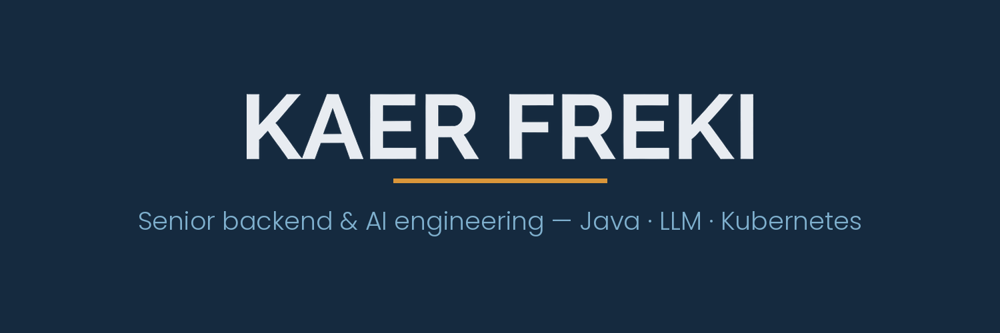

  

Senior backend engineer — 15 years of shipping software, from large-scale data pipelines to LLM-powered products in production.

I design and run distributed backends (**Java · PostgreSQL · Kubernetes**) and industrialize LLM integrations: model deployment, golden-set evaluation, prompt iteration, end-to-end delivery. I care about the distance between an impressive AI demo and a system you can actually rely on.

### Building here

| Repo | What it is | Status |
|---|---|---|
| `freki-llm-stack` | Self-hosted LLM inference stack — Ollama/vLLM, Docker & Kubernetes deployment, benchmarks | in progress |
### Elsewhere

- 🌐 [kaerfreki.fr](https://kaerfreki.fr) — CV & services (FR)
- ✉️ contact@kaerfreki.fr
- 📍 Lyon, France · working async, remote
